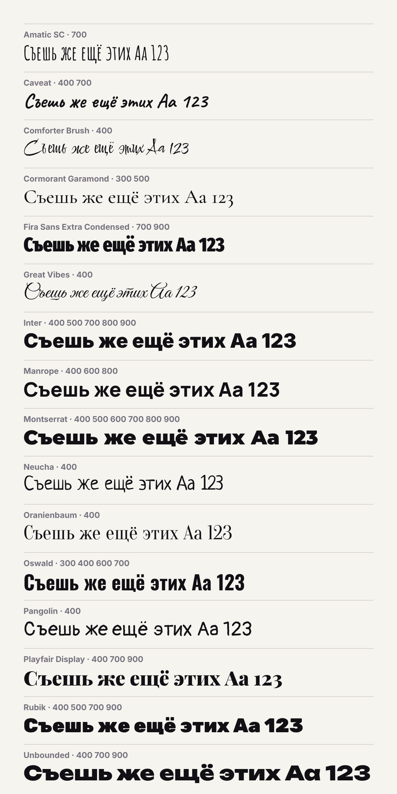

# Постеры и медиа для соцсетей

Макеты верстаются в HTML/CSS и рендерятся в PNG/JPG/PDF точного размера через Chromium.



## Быстрый старт

```bash
# рендер макета (размер берётся из <meta name="size">)
node scripts/render.cjs templates/post.html

# другой формат / JPG / PDF / двойное разрешение
node scripts/render.cjs projects/2026-10-16-sale/story.html --format story --jpg
node scripts/render.cjs projects/2026-10-16-poster/a3.html --format a3 --pdf

# добавить шрифт с Google Fonts
python3 scripts/get_font.py "Playfair Display" 400 700 --italic
```

Нужны Node.js и Playwright (`npm i -g playwright && npx playwright install chromium`) — в облачной сессии Claude Code уже установлены.

## Структура

- `projects/` — готовые работы, по папке на заказ: `ГГГГ-ММ-ДД-название/` с HTML, `assets/` и `export/`
- `templates/` — шаблоны поста 4:5, сторис 9:16 и карусели
- `brand/` — цвета, шрифты и логотипы бренда
- `fonts/` — шрифты с кириллицей (лицензия SIL OFL)
- `scripts/` — рендер и загрузка шрифтов
- `.claude/skills/canvas-design/` — скил [canvas-design](https://github.com/anthropics/skills/tree/main/skills/canvas-design) для арт-постеров (Apache 2.0, шрифты — OFL)

Подробные правила работы и форматы — в [CLAUDE.md](CLAUDE.md).
